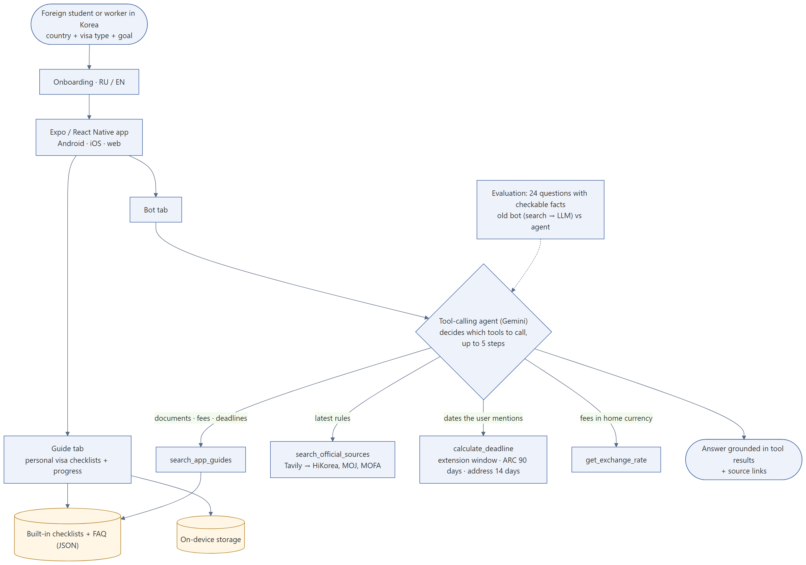

# Korea Visa Guide

A mobile app that helps foreign students and workers in Korea handle visa procedures: personal checklists for their visa type and a Q&A bot that answers from official sources.

Built with Expo / React Native (TypeScript), runs on Android, iOS and the web. Interface in Russian and English.

## Features

- **Onboarding:** country, current visa (D-2, D-4, D-10, E-7, F-2, F-4, F-5, F-6, G-1, H-2) and goal.
- **Personal checklists:** visa extension, part-time work permit, D-2 → D-10 status change, re-entry permit, address change, ARC registration. Each item has an explanation, deadline and fee; progress is saved on the device.
- **Live refresh:** Korean-language search queries pull current requirements from HiKorea; an LLM extracts the document list and fee.
- **Tool-calling agent:** the bot is a Gemini function-calling agent that decides which tools to use — the app's own verified guides, a search over official sites (HiKorea, Ministry of Justice, MOFA), a deadline calculator and live exchange rates — and answers only from tool results, pointing to HiKorea or the 1345 hotline when unsure.
- **Switchable LLM provider:** Gemini (falls back to a lighter model on overload), DeepSeek, or Claude through a server proxy.

## Architecture



| Tool | Used for |
|---|---|
| `search_app_guides` | documents, deadlines, fees from the built-in checklists and FAQ |
| `search_official_sources` | Tavily search limited to hikorea.go.kr, immigration.go.kr, mofa.go.kr, visa.go.kr |
| `calculate_deadline` | extension window (opens 4 months before expiry), ARC (90 days after entry), address change (14 days) |
| `get_exchange_rate` | converting KRW fees into the user's currency |

Code: [`src/agent/agent.ts`](src/agent/agent.ts) (loop, up to 5 steps) and [`src/agent/tools.ts`](src/agent/tools.ts).

## Evaluation

24 questions with checkable facts (fees, deadlines, date calculations, currency conversion), in Russian and English: [`eval/questions.json`](eval/questions.json). A question passes when the answer contains every required fact. Same Gemini model for both systems.

| System | Correct answers |
|---|---|
| Previous bot: web search → LLM | 8–13% (3 runs) |
| Tool-calling agent | 96–100% (3 runs) |

The agent picked the expected tool in 92–96% of questions. In the final run its only miss was a free-tier rate-limit error, not a wrong answer. The questions cover facts that are in the app's own guides, so this measures exactly the gap the agent fixes: the old bot could not see them and answered "not in the sources". Small test set; next step is more open-ended questions.


```bash
npx tsx eval/run.ts   # needs EXPO_PUBLIC_GEMINI_API_KEY and EXPO_PUBLIC_TAVILY_API_KEY
```

## Run

```bash
npm install
cp .env.example .env      # add your API keys
npx expo start            # press w for web, or scan the QR code with Expo Go
```

Keys: `EXPO_PUBLIC_GEMINI_API_KEY`, `DEEPSEEK_API_KEY`, `TAVILY_API_KEY`.

> Keys passed to the client are visible in the app bundle. For a public release, move LLM calls behind a small server proxy.

## Disclaimer

Information is for reference only and rules change. Always confirm with HiKorea (www.hikorea.go.kr) or call 1345.
